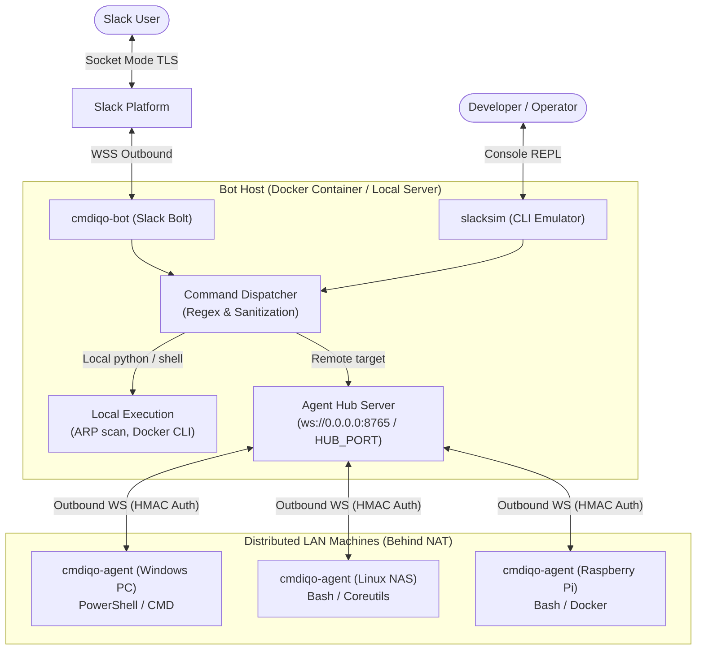
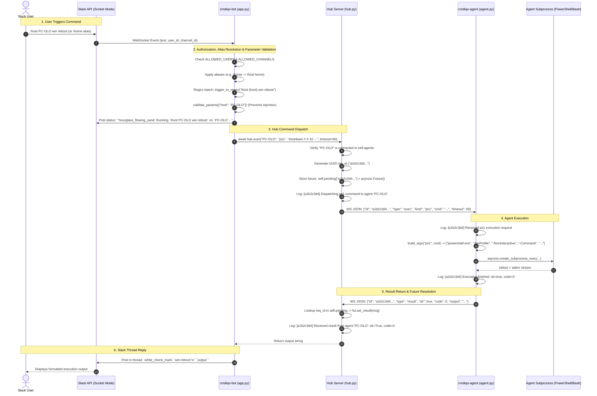
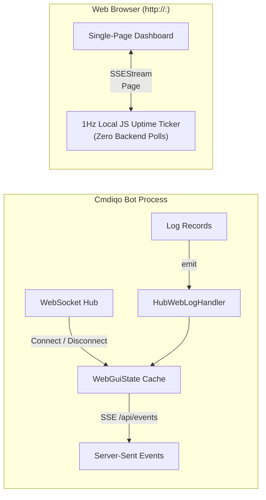

# Cmdiqo Architecture & Execution Flow

Cmdiqo is a hybrid home-lab management system that bridges **Slack Socket Mode** to your local network and distributed machines with **zero open ports** and **zero port forwarding**.

This document details the system architecture, end-to-end execution lifecycle, communication protocol, and logging observability.

---

## 1. High-Level Architecture

The system consists of three decoupled layers:
1. **Slack Cloud**: Interacts with users via Socket Mode (outbound WebSocket from the bot).
2. **cmdiqo-bot Container & slacksim**: Hosts the Slack event dispatcher, local command runner, and the WebSocket **Agent Hub**. `slacksim` provides an interactive console REPL for local testing and debugging without Slack credentials.
3. **cmdiqo-agent Instances**: Super-lightweight native C++20 standalone daemons running on LAN nodes (consuming only **~1.1 MB RAM on Linux** and **~3.3 MB RAM on Windows**, with the native Windows GUI installer taking just **~5.2 MB RAM**) that maintain persistent outbound WebSocket connections to the Hub.



---

## 2. End-to-End Execution Flow

When a user issues a command targeting a remote agent (for example, `/host PC-OLO win reboot` or via alias `/home ...`), the system executes the following sequence:



---

## 3. Communication Protocol

### Connection & Authentication Handshake
1. **Agent Initiates Outbound Connection**:
   - `ws://<hub_ip>:8765` (configurable via `export HUB_PORT=8765`, default: `8765`)
   - Headers: `Authorization: Bearer <AGENT_TOKEN>`
2. **Hub Token Verification**:
   - Evaluated via `hmac.compare_digest(expected, provided)` to eliminate timing side-channel attacks.
3. **Hello Handshake**:
   - The agent sends its identity and runtime metadata immediately upon connection:
   ```json
   {
     "type": "hello",
     "name": "PC-OLO",
     "version": "1.0.devel+6AB4BAC9",
     "platform": "windows",
     "arch": "x86_64"
   }
   ```
4. **Registration**:
   - Hub stores the WebSocket reference, version, platform, arch, remote IP, and connection timestamp in `self.agents["PC-OLO"]`.

### Execution Message Schema (`Hub` $\rightarrow$ `Agent`)
```json
{
  "id": "a1b2c3d4e5f67890123456789abcdef0",
  "type": "exec",
  "kind": "ps1",
  "cmd": "Get-Service | Where-Object {$_.Status -ne 'Running'} | Format-Table -AutoSize",
  "cwd": null,
  "timeout": 180
}
```

### Result Message Schema (`Agent` $\rightarrow$ `Hub`)
```json
{
  "id": "a1b2c3d4e5f67890123456789abcdef0",
  "type": "result",
  "ok": true,
  "code": 0,
  "output": "Status   Name               DisplayName\n------   ----               -----------\nStopped  ALG                Application Layer Gateway Service\n...",
  "error": null
}
```

---

## 4. Structured Observability & Logging

Every execution request carries a unique UUID, correlated across both server and agent logs via the first 8 characters:

| Component | Log Event | Example Log Entry |
|---|---|---|
| **Hub** | Command Dispatched | `[INFO] [a1b2c3d4] Dispatching ps1 command to agent 'PC-OLO': shutdown /r /t 10 ... (timeout=60s, cwd=(default))` |
| **Agent** | Command Received | `[INFO] [a1b2c3d4] Received ps1 execution request: shutdown /r /t 10 ... (timeout=60s, cwd=(default))` |
| **Agent** | Execution Completed | `[INFO] [a1b2c3d4] Execution finished: ok=True, code=0, out_bytes=42, error=none` |
| **Hub** | Result Received | `[DEBUG] [a1b2c3d4] Received result from agent 'PC-OLO': ok=True, code=0, out_bytes=42, error=none` |

---

## 5. Command Routing Matrix

Commands defined in `config/commands.yaml` (under `aliases:` and `commands:`) are routed dynamically based on their `command` mapping (`python | shell | ps1`), implicit host targeting via `{host}`, and configured alias rules:

| Command Trigger | `command` kinds | Target Resolution | Execution Location | Runtime / Handler |
|---|---|---|---|---|
| `/help [topic]` | `internal` | *(none)* | Bot App | Dynamic manual engine (inferred topic categories) |
| `/lan devices list` | `python` | Local | Bot Container | Internal Python handler (`commands.devices:list_devices`) |
| `/lan wake {target}` | `python` | Local | Bot Container | UDP Broadcast Magic Packet (`commands.devices:send_wake_on_lan`) |
| `/lan ping {host}` | `python` | Local | Bot Container | Local ping utility (`commands.devices:ping_host`) |
| `/lan agents list` | `internal` | Local | Hub Registry | Lists connected agents, OS platform, and remote addresses |
| `/host {host} users` | `python` | `{host}` | Host / Agent | Local user accounts & status inspection (Win & Linux) |
| `/host {host} user {user} {action}` | `python` | `{host}` | Host / Agent | User account status / enable / disable (Win & Linux) |
| `/host {host} uptime` | `shell` + `ps1` | `{host}` | Host / Agent | Cross-platform: Linux `uptime` / Windows `Win32_OperatingSystem` |
| `/host {host} memory` | `shell` + `ps1` | `{host}` | Host / Agent | Cross-platform: Linux `free -h` / Windows `Win32_OperatingSystem` |
| `/host {host} disk` | `shell` + `ps1` | `{host}` | Host / Agent | Cross-platform: Linux `df -h` / Windows `Win32_LogicalDisk` |
| `/host {host} top` | `shell` + `ps1` | `{host}` | Host / Agent | Cross-platform: Linux `ps aux` / Windows `Get-Process` |
| `/host {host} reboot` | `shell` + `ps1` | `{host}` | Host / Agent | Cross-platform: Linux `shutdown -r +1` / Windows `shutdown /r /t 10` |
| `/host {host} shutdown` | `shell` + `ps1` | `{host}` | Host / Agent | Cross-platform: Linux `shutdown -h +1` / Windows `shutdown /s /t 10` |
| `/host {host} services` | `shell` + `ps1` | `{host}` | Host / Agent | Cross-platform: Linux `systemctl list-units` / Windows `Get-Service` |
| `/host {host} service status {service}` | `shell` + `ps1` | `{host}` | Host / Agent | Cross-platform: Linux `systemctl status` / Windows `Get-Service` |
| `/host {host} service restart {service}` | `shell` + `ps1` | `{host}` | Host / Agent | Cross-platform: Linux `systemctl restart` / Windows `Restart-Service` |
| `/host {host} parental {action}` | `python` (with `config.domains`) | `{host}` | Host / Agent | Configurable parental domain blocker with DNS flush (Win & Linux) |
| `/host {host} blockapp {app} {action}` | `python` (with `config.apps`) | `{host}` | Host / Agent | Multi-process execution blocker via IFEO/AppX on Windows and Flatpak overrides on Linux (`commands.appblock:manage_appblock`, alias: `appblock`) |
| `/host {host} docker ps` | `shell` | `{host}` | Host / Agent | Linux `docker ps --format ...` |
| `/host {host} docker stats` | `shell` | `{host}` | Host / Agent | Linux `docker stats --no-stream ...` |
| `/host {host} win updates` | `ps1` | `{host}` | Windows Agent | Remote `powershell.exe` Get-CimInstance Win32_QuickFixEngineering |
| `/home <action>` *(alias)* | *n/a* | Host `home` | Alias Resolution | Auto-translates to `/host home <action>` |
| `/wol <target>` *(alias)* | *n/a* | Local | Alias Resolution | Auto-translates to `/lan wake <target>` |

> **Dynamic Help & Discovery Engine**: Typing `/help` generates an organized category manual directly from the `description`, `details`, and `examples` fields defined in `commands.yaml`. Specifying a topic (e.g. `/help lan`, `/help host`, `/help docker`, `/help home`, `/help blockapp`) renders focused command breakdowns with copy-pasteable examples. Submitting bare prefixes (e.g. `/lan`, `/host`, `/home`, `/wol`, `/blockapp`, `/appblock`) or appending a trailing `help` (e.g. `/lan help`, `/host help`, `/docker help`, `/parental help`, `/blockapp help`) automatically routes into the corresponding nested help topic.

---

## 6. Fault Tolerance & Resilience

- **Firewall & NAT Traversal**: All connections are outbound from the agents to the Hub; agents do not expose open listening ports.
- **WebSocket Keepalives**: Both Hub and Agent configure `ping_interval=20` and `ping_timeout=20` to prevent NAT timeouts and stateful firewall drops.
- **Mid-Flight Disconnect Protection**: If an agent disconnects while executing a command, `_cancel_pending_for_agent()` instantly cancels the awaiting `asyncio.Future` with `ConnectionResetError`, preventing the Slack caller from hanging until timeout.
- **Subprocess Timeout Guard**: If a command exceeds its configured `timeout`, the agent process tree is forcibly terminated (`proc.kill()`) and a failure result is returned.

---

## 7. Integrated Real-Time WebGUI (`WEB_PORT=<port>`)

When the `WEB_PORT` environment variable is defined with a valid port number (e.g. `WEB_PORT=8080`), the Cmdiqo Hub spawns an integrated Flask web server running concurrently in a background daemon thread:



- **Connected Agents Table**:
  - Sortable by **Arch**, **Host Name** (default ascending), **Operating System**, and **Uptime** with visual ascending/descending indicators (`▲▼`), highlighted active sort arrow, and automatic `localStorage` preference persistence.
  - Newly connected agents received via SSE are immediately inserted into the table in their properly sorted position.
  - Displays host name, architecture badge with 32x32 WebP icons (`WIN64`, `Linux64`, `ARM64`, `ARMv6`), operating system, and live standardized uptime (`<days>d <hours>h <m>m <s>s`).
  - Architecture and boot epoch timestamps are cached in-memory upon agent connection; reconnects/disconnects automatically update or purge the cache.
  - Client JavaScript ticks uptime every second locally without generating periodic network requests.
- **Latest Events Log**:
  - Maintained as a 50-entry ring buffer (`collections.deque(maxlen=50)`).
  - Automatically captures bot lifecycle events, agent connections/disconnections, and command executions via `HubWebLogHandler`.
  - Pushes real-time `log_entry` events to connected browsers via SSE.
