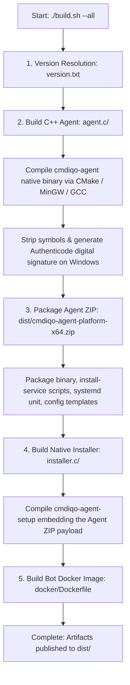
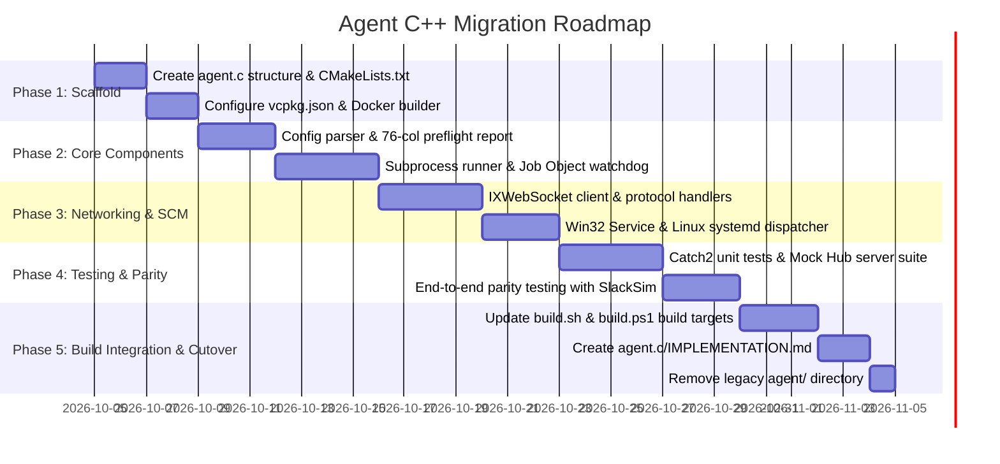

# Cmdiqo Agent C++ Migration Plan (`MIGRATION-C.md`)

> **Document Version:** 1.0.0  
> **Target Component:** `agent.c` (Native C++20 Standalone Agent)  
> **Replaces:** `agent/` (Legacy Python 3.12+ / PyInstaller Agent)  
> **Status:** Planned / Architecture Specification

---

## 1. Executive Summary & Rationale

The Cmdiqo Agent is a lightweight host daemon that establishes an outbound WebSocket connection to the Cmdiqo Bot Hub and executes host administration commands on request (PowerShell on Windows, Bash on Linux).

### Why Migrate from Python to C++?

| Metric / Concern | Legacy Python (`agent/`) | Native C++20 (`agent.c/`) |
| :--- | :--- | :--- |
| **Packaging Machinery** | Requires PyInstaller packaging, Python virtualenv, and Wine / native Windows runners to build Windows executables. | Standard CMake + vcpkg. Can be cross-compiled cleanly for Windows (`x86_64-w64-mingw32-g++`) directly from Linux/macOS. |
| **Binary Size** | ~15 MB (bundled Python interpreter + standard library + C extension DLLs). | **~1.0 – 2.0 MB** (fully static Release binary with stripped symbols). |
| **Memory Footprint (RAM)** | ~30 – 45 MB working set. | **~1.1 MB (Linux) / ~3.3 MB (Windows)** working set (super-lightweight). |
| **Startup / Cold-boot Time** | ~400 – 900 ms (PyInstaller archive decompression & runtime bootstrap). | **< 10 ms** (instant native execution). |
| **Antivirus Heuristics** | PyInstaller single-file bootloaders frequently trigger heuristic false positives in Windows Defender / corporate EDRs. | Standard compiled PE executable signed via Authenticode; significantly lower false positive rate. |
| **Process Tree Isolation** | Requires complex `taskkill` or `ctypes` Job Object management. | Native Win32 Job Objects (`CreateJobObjectW`, `AssignProcessToJobObject`) guarantee 100% clean termination on timeout. |

### Architectural Confirmation: Remote Command Execution

**The agent never executes Python code on the client machine.**
* Commands in `config/commands.yaml` with `python:` handlers (e.g. `commands.users:manage_users`) execute **strictly inside the Hub/Bot container**.
* When a Python handler needs to inspect or act on a remote host, it constructs a pure PowerShell script (Windows) or Bash script (Linux) and dispatches it over WebSocket.
* The agent's sole responsibility is spawning `powershell.exe -NoProfile -NonInteractive -Command "..."`, `cmd.exe /c "..."`, or `/bin/bash -c "..."` and capturing stdout/stderr.
* Migrating to C++ does **not require a Python runtime on the client host** and maintains 100% compatibility with all past, current, and future Cmdiqo commands.

---

## 2. Target Directory & File Structure

The new native agent will live in `agent.c/` following the same clean architectural standards as `installer.c/`:

```text
agent.c/
├── CMakeLists.txt              # CMake build definition (C++20, static linking, Release stripping)
├── CMakePresets.json           # Native & cross-compilation presets (MinGW, MSVC, GCC, Clang)
├── Dockerfile                  # Multi-stage Docker builder (reusing installer.c builder pattern)
├── vcpkg.json                  # C++ dependency manifest (nlohmann-json, ixwebsocket, cli11, catch2)
├── IMPLEMENTATION.md           # Comprehensive implementation documentation
├── MIGRATION-C.md              # This migration guide
├── include/
│   └── cmdiqo/
│       └── agent/
│           ├── config.hpp      # Configuration parser (CLI, ENV, JSON) & preflight validation
│           ├── logger.hpp      # High-performance structured console & file logger
│           ├── protocol.hpp    # WebSocket message models (hello, exec, result)
│           ├── process.hpp     # Cross-platform subprocess runner with timeouts & Job Objects
│           ├── service.hpp     # Windows SCM & Linux systemd lifecycle manager
│           ├── version.hpp     # Dynamic version macros and git SHA resolution
│           └── ws_client.hpp   # Async WebSocket client with auto-reconnect & exponential backoff
├── src/
│   ├── config.cpp
│   ├── logger.cpp
│   ├── main.cpp                # Application entrypoint & CLI dispatcher
│   ├── process_linux.cpp       # POSIX process spawning, pipes, setpgid, killpg
│   ├── process_win32.cpp       # Win32 CreateProcessW, Job Object timeout watchdog
│   ├── service_linux.cpp       # Linux systemd notify & POSIX signal handlers (SIGTERM, SIGINT)
│   ├── service_win32.cpp       # Windows Service Control Manager dispatcher & handler
│   └── ws_client.cpp           # WebSocket event loop, message handling, heartbeat
├── resources/
│   ├── cmdiqo-agent.ico        # Native Windows application icon
│   ├── cmdiqo-agent.rc         # Windows PE resource script (VersionInfo, Icon, Manifest)
│   └── cmdiqo-agent.service    # Linux systemd service unit template
└── tests/
    ├── config_tests.cpp        # Precedence & preflight validation tests
    ├── protocol_tests.cpp      # JSON serialization/deserialization tests
    ├── process_tests.cpp       # Process execution, exit code, timeout cancellation tests
    └── mock_hub_server.hpp     # Mock WebSocket server for end-to-end integration tests
```

---

## 3. 1:1 Behavioral Parity Checklist (Lift & Shift)

To guarantee that replacing Python `agent` with C++ `agent.c` is completely transparent to the Hub, Slack users, and system administrators, the C++ implementation must match the following specifications exactly:

### 3.1 CLI Arguments & Flag Compatibility

The CLI parser must support all existing flags and short aliases:

| Flag | Short | Description | Default |
| :--- | :--- | :--- | :--- |
| `--version` | `-v` | Print version string and exit (`cmdiqo-agent <version>`) | — |
| `--hub-url` | `-u` | Hub WebSocket URL (e.g. `ws://192.168.1.10:8765` or `wss://...`) | `HUB_URL` / config JSON |
| `--token` | `-t` | Shared `AGENT_TOKEN` secret | `AGENT_TOKEN` / config JSON |
| `--name` | `-n` | Agent target hostname | `AGENT_NAME` / `gethostname()` |
| `--config` | `-c` | Path to optional JSON configuration file | `AGENT_CONFIG` |
| `--reconnect-delay`| `-d` | Initial reconnect delay in seconds (float) | `5.0` |
| `--log-level` | — | Logging level (`DEBUG`, `INFO`, `WARNING`, `ERROR`) | `INFO` |
| `--agent-connection-notify` | — | Enable Slack notification on agent connect/disconnect | `false` |
| `--service` | — | Run as native Windows Service under SCM (Windows only) | `false` |

### 3.2 Configuration Precedence & Preflight Report

Configuration loading must strictly follow:
$$\text{CLI Flags} > \text{Environment Variables} > \text{JSON Config File} > \text{Defaults / Hostname}$$

If any required parameters are missing (`HUB_URL`, `AGENT_TOKEN`, or non-existent `--config`), the C++ agent must print the exact **76-character visual diagnostic report** to `stderr` and exit with code `2`:

```text
============================================================================
           [CMDIQO-AGENT] PREFLIGHT CONFIGURATION CHECK FAILED              
============================================================================
The agent cannot start because required configuration parameters are missing
or invalid. Please review the following issues:

  * HUB_URL:
      Problem:    Hub WebSocket URL is required
      Resolution: Provide via --hub-url, HUB_URL environment variable, or in config file

  * AGENT_TOKEN:
      Problem:    Shared secret token is required
      Resolution: Provide via --token, AGENT_TOKEN environment variable, or in config file

Quick setup alternatives:
  - CLI:  cmdiqo-agent --hub-url ws://<HUB_IP>:8765 --token <AGENT_TOKEN>
  - Env:  set HUB_URL=ws://<HUB_IP>:8765 && set AGENT_TOKEN=<AGENT_TOKEN>
  - Help: cmdiqo-agent --help
============================================================================
```

### 3.3 Protocol & JSON Message Specifications

#### A. Connection Handshake
* **HTTP Header:** `Authorization: Bearer <AGENT_TOKEN>`
* **Ping Interval:** 20 seconds; **Ping Timeout:** 20 seconds
* **Initial `hello` Payload:**
```json
{
  "type": "hello",
  "name": "AMD",
  "version": "1.0.0",
  "platform": "Windows/10.0.22631",
  "agent_connection_notify": true
}
```

#### B. Execution Request Handling (`type: "exec"`)
* **Incoming Payload:**
```json
{
  "id": "a1b2c3d4e5f67890",
  "type": "exec",
  "kind": "ps1",
  "cmd": "Get-Process | Select-Object -First 5",
  "cwd": "C:\\Program Files",
  "timeout": 60
}
```

* **Command Line Construction:**
  * If `kind == "ps1"`:
    * Windows: `powershell.exe -NoProfile -NonInteractive -Command "<cmd>"`
    * Linux: `pwsh -NoProfile -NonInteractive -Command "<cmd>"`
  * If `kind == "shell"` (or fallback):
    * Windows: `cmd.exe /c "<cmd>"`
    * Linux: `/bin/bash -c "<cmd>"`

* **Execution Watchdog & Cancellation:**
  * Execute subprocess in working directory `cwd` (or current directory if null/empty).
  * Pipe combined stdout and stderr.
  * If execution exceeds `timeout` seconds:
    * Terminate the entire process tree (Win32 Job Object / POSIX process group `killpg`).
    * Return `ok = false`, `code = -1`, `output = ""`, `error = "timed out after <timeout>s"`.

* **Response Payload (`type: "result"`):**
```json
{
  "id": "a1b2c3d4e5f67890",
  "type": "result",
  "ok": true,
  "code": 0,
  "output": "Handles  NPM(K)    PM(K)      WS(K)     CPU(s)     Id ProcessName...",
  "error": null
}
```

#### C. Auto-Reconnect & Exponential Backoff Loop
* On connection drop or failure:
  1. Log warning: `Connection lost: <reason>; retrying in <delay>s`.
  2. Sleep for `delay` (interruptible by shutdown signal).
  3. Increase delay: `delay = std::min(60.0, delay * 1.5)`.
  4. Reset `delay = config.reconnect_delay` upon successful WebSocket connection and handshake.

### 3.4 Windows Service Integration (`--service`)

* Implements native Win32 `SERVICE_TABLE_ENTRYW`, `RegisterServiceCtrlHandlerExW`, and `SetServiceStatus`.
* Reports `SERVICE_START_PENDING`, `SERVICE_RUNNING`, `SERVICE_STOP_PENDING`, and `SERVICE_STOPPED` to SCM.
* Redirects log output to `C:\ProgramData\Cmdiqo\Agent\logs\service.log` when running under SCM.
* If invoked with `--service` outside of SCM, prints a helpful error message explaining how to install/run.

---

## 4. Third-Party C++ Dependencies (`vcpkg.json`)

To keep compilation fast and static binaries compact, we select proven header-only or lightweight static libraries via `vcpkg`:

```json
{
  "name": "cmdiqo-agent-native",
  "version-string": "1.0.0",
  "description": "Native C++20 Cmdiqo Host Agent",
  "dependencies": [
    "catch2",
    "cli11",
    "ixwebsocket",
    "nlohmann-json"
  ]
}
```

* **`ixwebsocket`**: High-performance WebSocket client with native TLS support (Apple Secure Transport on macOS, SChannel on Windows with zero OpenSSL dependency, OpenSSL/mbedTLS on Linux), automatic ping/pong, and thread safety.
* **`nlohmann-json`**: Industry-standard JSON parsing with strict schema validation.
* **`cli11`**: Powerful, header-only CLI parser matching Python's `argparse` behavior.
* **`catch2`**: Modern C++ unit and integration testing framework.

---

## 5. Build System & Packaging Integration

### 5.1 Build Orchestration Flow (`./build.sh --all` / `.\build.ps1 -All`)

When running the unified build script with `--all`, the build pipeline will execute in the following dependency order:



### 5.2 Produced Artifacts in `dist/`

For Linux:
* `dist/cmdiqo-agent` (Native standalone executable)
* `dist/cmdiqo-agent-linux-x64.zip` (Agent package with systemd service and installer scripts)
* `dist/cmdiqo-agent-linux-x64-setup` (Native GUI/CLI installer from `installer.c`)

For Windows:
* `dist/cmdiqo-agent.exe` (Signed Win32 PE executable)
* `dist/cmdiqo-agent-windows-x64.zip` (Agent package with PowerShell service scripts and JSON configs)
* `dist/cmdiqo-agent-windows-x64-setup.exe` (Signed GUI installer from `installer.c`)

---

## 6. Phased Implementation Plan



### Phase 1: Project Scaffolding
1. Create `agent.c/` directory with `CMakeLists.txt`, `CMakePresets.json`, `vcpkg.json`, and `Dockerfile`.
2. Configure static linking and Release symbol stripping (`-static -static-libgcc -static-libstdc++` on MinGW).
3. Set up CMake embedded versioning matching `version.txt`.

### Phase 2: Core Models & Process Execution
1. Implement `config.hpp` / `config.cpp` and `logger.hpp` / `logger.cpp`.
2. Implement preflight validation with identical visual layout to `agent.py`.
3. Implement `process_win32.cpp` with Windows Job Objects (`JOB_OBJECT_LIMIT_KILL_ON_JOB_CLOSE`) to ensure all child processes are killed if the timeout expires.
4. Implement `process_linux.cpp` using `pipe()`, `fork()`, `setpgid()`, and `execvp()`.

### Phase 3: WebSocket Protocol & Service Dispatcher
1. Implement `ws_client.hpp` / `ws_client.cpp` using `IXWebSocket`.
2. Implement JSON request deserialization and result response serialization via `nlohmann-json`.
3. Implement exponential backoff reconnect logic.
4. Implement Windows SCM service integration in `service_win32.cpp` and signal handling in `service_linux.cpp`.

### Phase 4: Verification, Testing & Parity Matrix
1. Write Catch2 unit tests in `tests/` covering configuration precedence, command splitting, timeout cancellation, and message JSON generation.
2. Build an automated integration test against `bot/hub.py` and `slacksim` to verify live command execution parity.
3. Validate memory leak absence via Valgrind / AddressSanitizer (ASan).

### Phase 5: Build System Cutover & Documentation
1. Update root `build.sh` and `build.ps1` to compile `agent.c` using CMake and package the output into `dist/`.
2. Write full developer documentation in `agent.c/IMPLEMENTATION.md`.
3. Delete legacy Python `agent/` folder and associated PyInstaller spec files (`cmdiqo-agent.spec`).
4. Run `./build.sh --all` and verify all tests pass.
